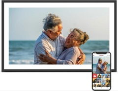
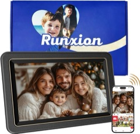

# Device index

Every frame documented in this repo. Each row is a record of the units its owners tested.
Frames sold under the same name can have different boards, so match the About screen, not the
brand: the same Amazon listing has shipped different boards. Links on amazon.com are affiliate
links. Rows marked "no write-up yet" are confirmed working but not documented here; notes are
welcome. Missing yours? See the README's
[contributing section](../README.md#check-for-updates-and-send-back-what-you-find).

| Device&nbsp;&nbsp;&nbsp;&nbsp;&nbsp;&nbsp;&nbsp;&nbsp;&nbsp;&nbsp;&nbsp;&nbsp;&nbsp;&nbsp;&nbsp;&nbsp;&nbsp;&nbsp;&nbsp;&nbsp;&nbsp;&nbsp;&nbsp;&nbsp;&nbsp;&nbsp;&nbsp;&nbsp;&nbsp;&nbsp; | SoC, Android | ADB out of the box | Root | Start with | Where owners bought it |
| --- | --- | --- | --- | --- | --- |
|  Skylight Calendar 15" (150-CAL) | Rockchip RK3566, Android 12 | No. Hidden 5-tap manufacturer menu | Boot ramdisk `/force_debuggable`, then `adb root` | [next-session.md](next-session.md) | [Amazon](https://www.amazon.com/dp/B0C9V811L6?tag=webo080-20) |
|  BIUFRAME 10.1" (Synergy 10X1), the frame in the video | Rockchip RK3126, Android 6.0.1 | Yes, USB, accept the prompt | Shipped SuperSU `su` | [biuframe-setup-guide.md](biuframe-setup-guide.md) | [Amazon](https://amzn.to/4zneGNM), the listing from the video. It now often ships the PF1007L (#27) |
|  PF1007L / AiMOR (sold as BIUFRAME and others) | Allwinner A33, Android 6.0.1 | Varies by firmware | Boot patch, or root ADB once `adbd` runs | [pf1007l-start-here.md](pf1007l-start-here.md) | Reported from [Humblestead, US](https://amzn.to/4zneGNM) (#27), [Humblestead, Spain](https://www.amazon.es/dp/B0GGB7LWX8) (#18) and [Anna Bella, Canada](https://www.amazon.ca/dp/B0H4W1YPHH) (#28) |
| Joyhong JT101F-I02 (Frameo) | Allwinner A33, Android 6.0.1 | **Yes, root over Wi-Fi, no key check** | Root ADB | [joyhong-jt101f-i02.md](joyhong-jt101f-i02.md) | Not recorded |
|  Dragon Touch Modern10 Charm (VPhoto) | Allwinner A33 (inferred; same `astar_ococci` platform as the Joyhong), Android 6.0.1 | Yes, root over Wi-Fi | Root ADB | [dragontouch-modern10-charm.md](dragontouch-modern10-charm.md) | [Amazon US](https://www.amazon.com/dp/B0D8J5PNFH?tag=webo080-20) (same model name; the tested unit came from [Amazon UK](https://www.amazon.co.uk/dp/B0DXV3HGH7)) |
|  Pastigio FRAME156 15.6" (Frameo) | Rockchip RK3326, Android 8.1 | Frameo Settings → Beta → ADB Access | Shipped `su` | [pastigio-frame156.md](pastigio-frame156.md) | [Amazon](https://www.amazon.com/dp/B0CQN2PKQR?tag=webo080-20) (sold as FRAME156; not confirmed as the tested listing) |
| VESWWE DP100 10.1" (Frameo) | Rockchip RK3326 (S101 board), Android 8.1, NAND | Frameo beta menu, USB | Shipped `su` and `adb root` | [veswwe-10.1.md](veswwe-10.1.md) | Not recorded |
| Uhale SI006 | Spreadtrum `sp7731g_1h10`, Android 6.0 | No. Hidden Settings, then `unauthorized` | Terminal app `su`, then host key added to `adb_keys` | [si006-uhale.md](si006-uhale.md) | Not recorded |
|  Runxion 10.1" (Frameo) | Not documented yet | Not documented yet | Not documented yet | Confirmed working; no write-up yet | [Runxion 10.1" Frameo, 32 GB](https://amzn.to/4B38DQ0) |
|  15.6" Frameo | Not documented yet | Not documented yet | Not documented yet | Confirmed working; no write-up yet | [15.6" Frameo, 1920x1080](https://amzn.to/4zwU6e0) |

## Patterns so far

- **Frameo frames** often have an ADB toggle under Settings → About → Beta Program.
- **Try ADB over the network** (`adb connect <ip>:5555`) as well as USB. Several Allwinner frames
  ship with root ADB open on Wi-Fi with no key check. That is convenient, but anything on the same
  network gets root, so keep these frames on an isolated network.
- **No SystemUI** (no status or navigation bar) is common. Then an ADB `unauthorized` prompt has
  nowhere to appear.
- **Cables:** several USB-C frames need a USB-A to USB-C data cable. The cable in the box is often
  power only.
