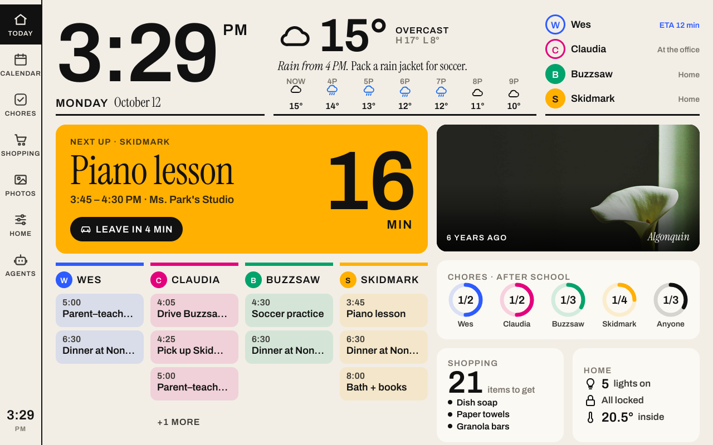

# Dragon Touch Modern10 Charm (VPhoto): Wi-Fi root ADB and Firefox dashboard

Report from **one unit**, tested on **12 October 2026** using an **Apple silicon Mac,
macOS 27.0 (26A428)**. The owner bought it from
[Amazon UK, ASIN B0DXV3HGH7](https://www.amazon.co.uk/dp/B0DXV3HGH7).
The listing identifies the purchase, not a guarantee that another unit has this firmware.

**Verified result:** root ADB was already reachable over Wi-Fi. After a private, verified
backup, Rootless Pixel Launcher 3.9.1 and Firefox 143.0.4 ARMv7 were installed. The hosted
dashboard runs full-screen through Firefox's **Home HQ** home-screen shortcut, with the
stock system WebView retained. This is a browser setup; the repository's native kiosk APK
has not been tested on this unit.



## Identity and observations

| Item | Observed value |
| --- | --- |
| Model in Settings / properties | `Modern10 charm` |
| Firmware build | `Modern10 charm_A33MAU_202605151735_4.0_V01` |
| Android / SDK | `6.0.1` / `23` |
| Manufacturer / board / hardware | `joyhong` / `exdroid` / `sun8i` |
| Build fingerprint | `joy/astar_ococci/astar-ococci:6.0.1/MOB30R/20260515:user/test-keys` |
| CPU ABI | `armeabi-v7a` |
| Display / density | `1280x800` / `160` |
| Stock home app | VPhoto, `com.waophoto.smartframe` |
| Vendor updater | `com.waophoto.fota` |
| Stock WebView | `44.0.2403.119` |
| ADB shell identity | `uid=0(root)`, `gid=0(root)`, SELinux context `u:r:su:s0` |

The build's `A33` marker and `sun8i` hardware property suggest an **Allwinner A33-family**
board. The chip was not physically inspected. This is different firmware from the
PF1007L / AiMOR units. Neither the Rockchip `apply` script nor the PF1007L boot-patch routes
were used; those routes are not validated for this frame.

The owner reports a **USB-A port**. With a USB-A-to-USB-C cable connecting it to the Mac,
`system_profiler SPUSBHostDataType` showed no connected USB device. USB ADB was not obtained
with that combination. This does not establish whether another cable, port or mode would work.

## ADB access

The frame was already connected to Wi-Fi. Connecting to TCP port **5555** succeeded without
an authorization prompt, and the shell was already root. No developer-menu change, `adb tcpip`,
vendor-app trick, root installation or boot patch was needed during this session. Factory-reset
state and the persistence of this access across reboot have not been tested.

With Android platform-tools installed, replace the example address with the IP shown in the
frame's Settings. Read-only identity checks:

```sh
FRAME_IP='FRAME_IP_FROM_SETTINGS'
adb connect "$FRAME_IP:5555"
adb -s "$FRAME_IP:5555" shell id
adb -s "$FRAME_IP:5555" shell getprop ro.product.model
adb -s "$FRAME_IP:5555" shell getprop ro.build.display.id
adb -s "$FRAME_IP:5555" shell getprop ro.build.version.release
adb -s "$FRAME_IP:5555" shell getprop ro.hardware
adb -s "$FRAME_IP:5555" shell getprop ro.product.cpu.abi
```

Check your unit before making changes. Root ADB without an authorization prompt grants broad
access to anyone who can reach that port; keep it on a trusted network and do not expose it
to the internet. Changing ADB authentication or disabling network ADB was not part of this trial.

## Backup before app installation

A private live capture of the whole eMMC user area and both hardware boot areas completed
before installing apps. No firmware images or backup hashes are included in this report.

| Area | Raw bytes |
| --- | ---: |
| eMMC user area | 15,758,000,128 |
| eMMC boot0 | 4,194,304 |
| eMMC boot1 | 4,194,304 |

Verification checked exact raw byte counts, streamed SHA-256 against full gzip readback,
gzip integrity and uniform 64 KiB `0xCC` filler. Eight fresh reads matched the saved bytes:
both hardware boot areas, the disk header, a system-data sample, env, boot, recovery and
bootloader. Full boot, recovery, env and bootloader reads through their partition devices
also matched the corresponding whole-image ranges.

Two compatibility findings:

- Stock Android Toolbox `dd` returned `Invalid argument` and zero bytes when seeking to
  recovery beyond 2 GiB. **BusyBox `dd` worked** for the same offset. Use the partition map
  read from your own unit; do not reuse another model's offsets.
- The first 8 KiB of the live system partition differed in six bytes in the ext4 mount-time,
  mount-count and lifetime-write counters. Their locations are documented in the
  [Linux ext4 superblock layout](https://www.kernel.org/doc/html/latest/filesystems/ext4/super.html).
  A fresh 16 MiB system-data read starting 128 MiB into that partition matched the saved
  whole-image range. The mutable superblock bytes were not counted as a matching check.

Android was running during capture: writable filesystems were not frozen into an atomic
offline snapshot, and **restore has not been tested**. These are backup observations, not a
recovery or flashing guide.

## Launcher and browser setup

Only these two apps were added. The pinned builds also appear in
[biuframe-setup-guide.md](biuframe-setup-guide.md); that guide's device-specific system changes
were not applied here.

| App | Source | SHA-256 |
| --- | --- | --- |
| Rootless Pixel Launcher 3.9.1 | [F-Droid APK](https://f-droid.org/repo/amirz.rootless.nexuslauncher_30911.apk) | `7fa44d560dc4577374d45176220de2c0b00a71e09d6d148cdea4e0a52d38404a` |
| Firefox 143.0.4 ARMv7 | [Mozilla archive APK](https://archive.mozilla.org/pub/fenix/releases/143.0.4/android/fenix-143.0.4-android-armeabi-v7a/fenix-143.0.4.multi.android-armeabi-v7a.apk) | `af560738627d4efc9ace75e708fc48aad6a24c78ef43a89daca27e16ff3829f8` |

Both APKs passed source hash, Android signature and minimum-SDK checks (both require SDK 21).
Firefox's ARMv7 ABI matched the frame. APKs were transferred to `/data/local/tmp`, their
on-device hashes checked, then installed with root-shell `pm install`. Installed package
versions were verified and temporary APK copies removed. Package IDs are
`amirz.rootless.nexuslauncher` and `org.mozilla.firefox`.

To reproduce the UI setup after installing the verified APKs:

1. Open Rootless Pixel Launcher. In **Select home app**, choose **Rootless Pixel Launcher**
   and **Always**. The other choice on this unit was VPhoto.
2. Open Firefox, complete its initial onboarding, and visit
   [the hosted demo](https://home-dashboard.wesbos.workers.dev/).
3. In Firefox's menu, choose **Add to Home screen**. The **Home HQ** shortcut appeared on
   Rootless's home screen. Open that shortcut.
4. Verify that it opens full-screen without Firefox's normal toolbar. On this unit the
   activity was `org.mozilla.firefox/org.mozilla.fenix.customtabs.ExternalAppBrowserActivity`.
5. Try **Calendar**, then press and hold the small clock at the bottom left for about one
   second to open the demo-controls drawer. Both were tested successfully by touch.

The dashboard's manifest requests `fullscreen` and landscape orientation. Firefox uses its
own engine, so this route did not require replacing the stock WebView 44. The screenshot
above is a 1280x800 device capture of the working Today view.

The hosted demo contains sample people, events, weather and devices. Its clock initially
starts at 15:18 rather than the frame's real time. It returns to Today after 60 seconds idle
and enters ambient mode after 120 seconds. This is the demo's behaviour, not a device fault.
The frame fetches the hosted site directly over Wi-Fi; the Mac does not need to stay connected.

## Scope, exit and undo

- The repository's native kiosk app and its two-finger exit gesture are **not** part of this
  Firefox setup. Android navigation controls were hidden during the trial. ADB can return to
  the launcher with `adb -s "$FRAME_IP:5555" shell input keyevent 3`.
- To restore the vendor home app, open Android **Settings → Home** from Rootless's app drawer
  and choose **VPhoto**. The installed apps can remain available for another trial.
- VPhoto and its updater remain installed and enabled. They were not audited for remote
  commands; the AiMOR findings from another model should not be attributed to VPhoto.
  The [Joyhong JT101F-I02](joyhong-jt101f-i02.md) has the same platform (`astar_ococci`) and the
  same updater, `com.waophoto.fota`. There it is privileged, with `INSTALL_PACKAGES` and
  `REBOOT`. Consider `pm disable com.waophoto.fota` before the frame stays online.
- No system WebView replacement, CA-root changes, swap setup, boot patch or direct firmware
  writes were performed. The stock screen timeout was retained.
- Automatic dashboard startup after reboot, offline use, long-term stability and firmware
  restore are **not verified**. This report establishes the browser dashboard on this build,
  not full kiosk support for all Modern10 Charm units.

The local source checkout used for the trial was
`9dd323e7974f1d4cc10935044386101f9c18e6d0`. Check the current repository and the identity of
your own frame before adapting these observations.
